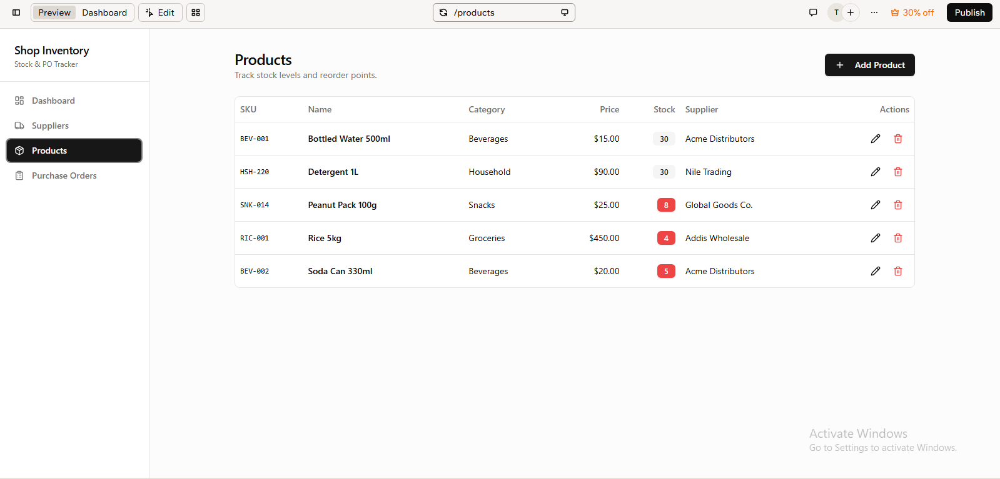
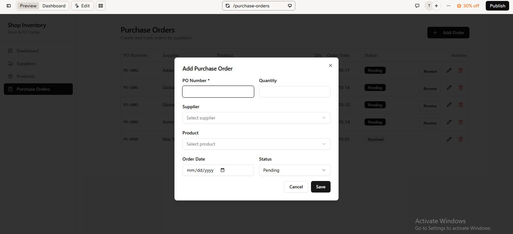
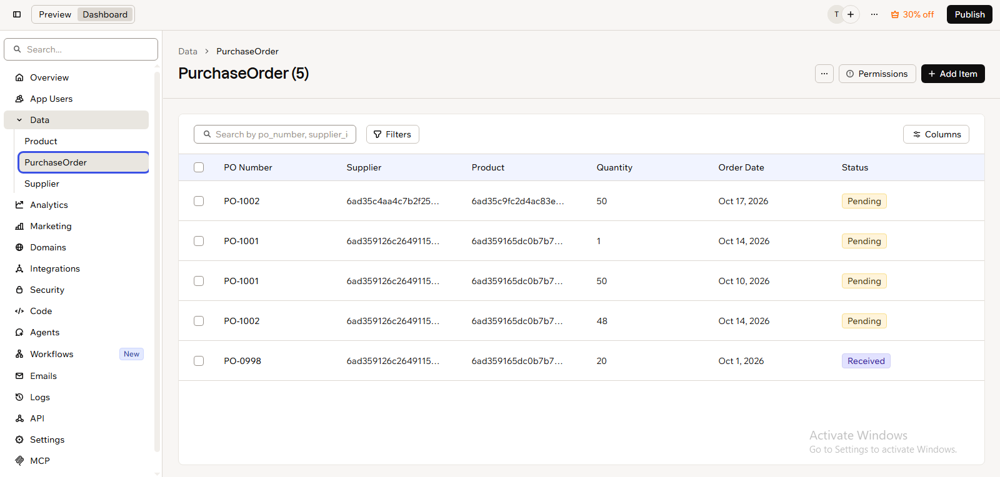
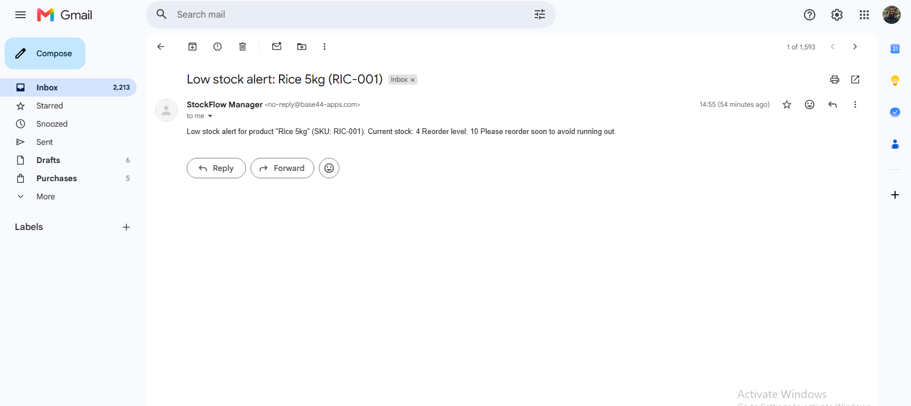

# Inventory & Purchase Order Tracker (Base44)

A small retail inventory and purchase order system built on Base44, a low-code platform. I built it to practice the core tasks of an ERP administrator: structuring data, importing files, and automating alerts.

## What it does
- Tracks suppliers, products, and purchase orders
- Links records between tables using foreign keys
- Sends an automatic email when a product's stock falls below its reorder level

## Data structure (entities)
- **Suppliers:** name, phone, email, country
- **Products:** SKU, name, category, price, stock, reorder level, supplier
- **Purchase Orders:** PO number, supplier, product, quantity, order date, status (Pending / Received)

One supplier can have many products and many purchase orders (one-to-many). Purchase orders link to other tables through `supplier_id` and `product_id`.

## What I did
1. **Built the schema:** three linked entities with dropdowns for supplier and product.
2. **Cleaned and imported data:** removed a duplicate supplier in Excel, saved as CSV (`suppliers.csv`), and imported it by mapping columns to fields.
3. **Built an automation:** trigger = a product is created or updated, condition = stock is lower than the reorder level, action = send an email alert. I tested it with Rice 5kg (stock 4, reorder level 10).
4. **Practiced API basics:** sent GET requests in Postman and read the JSON responses.

## Screenshots

### Products page

### Purchase order form with supplier and product dropdowns

### PurchaseOrder entity fields (foreign keys)

### Low-stock email alert

## Tools
Base44, Excel (CSV cleaning), Postman

## What I would improve next
- Show only the products that belong to the chosen supplier in the purchase order form
- Update stock automatically when a purchase order is marked Received
- Connect the app to another tool through an API or webhook
